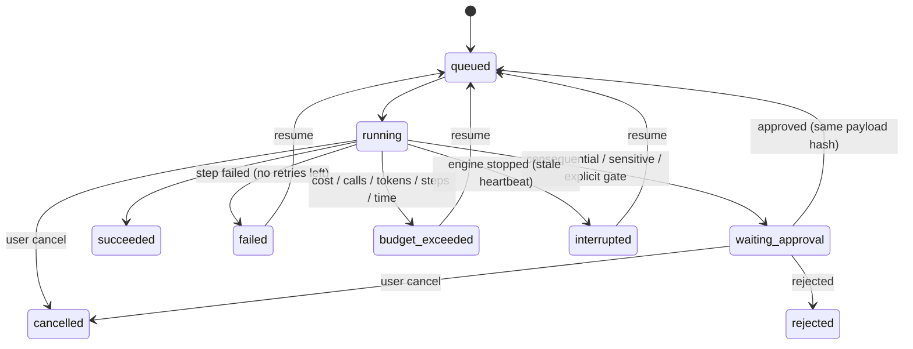
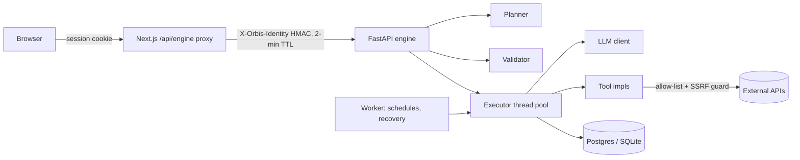

# Part 7 — AI Lab, Intelligence Composer & Intent-to-Outcome Engine

AI Lab turns a goal into a plan, the plan into a workflow, and the workflow into
an auditable run. People stay in control at three points:

1. They review the **plan** before anything is built.
2. They **publish** an immutable version before anything runs live.
3. They **approve** every consequential action, sensitive data share and irreversible change, seeing exactly what will happen.

Code: `engine/orbis_engine/lab/*` (Python), `engine/orbis_engine/security/*`, `src/components/lab/*` (UI), proxied by `src/app/api/engine/[...path]`.

---

## 1. Concepts

| Term | What it is |
|---|---|
| **Intent-to-Outcome Engine** | Goal text → `Plan` (tasks, dependencies, tools, models, assumptions, open questions, success criteria, risks, estimate) → workflow draft. Rule-based by default; it can ask a model to draft, but policy is always re-applied (`planner.finalize`). |
| **Intelligence Composer** | The visual builder (React Flow) for workflow graphs: steps, dependencies, branches, settings, tests, versions. |
| **Workflow** | A named, versioned graph (`WorkflowSpec`). The draft is editable; published versions are immutable and identified by a content hash. |
| **Run** | One execution of a pinned version, in `live`, `dry_run` (no external effects) or `test` mode, with checkpointed step outputs, a usage ledger, an event log, approvals and an outbox of external actions. |

## 2. Screens

| Route | Screen | Key elements |
|---|---|---|
| `/lab` | **Goal → Plan** | Goal box with examples; option to use a model planner. The plan review shows the interpretation, assumptions, success criteria and open questions. Each task card has an editable title, kind, tool or model, dependency chips, risk badge and an **needs your approval** badge. Also: add/remove steps, re-check (re-applies policy and estimate), estimate bar (model calls, cost or "unknown", approval gates, external services), and **Build workflow**. |
| `/lab/workflows/[id]` | **Composer** | Toolbar: name, status and version, "draft differs from vN" badge, validity, **Save draft / Publish / Run**. Layout: palette of 8 step types, canvas (solid dependency edges, dashed "if true/false" branch edges, red outline for invalid steps), right panel with four tabs (described below). |
| (dialog) | **Run** | Mode (dry run or live on the published version), input form (sensitive inputs masked), and a budget reminder. |
| `/lab/runs/[id]` | **Run view** | Status, cancel and resume. Usage tiles against budget limits, and an approval card showing the exact payload (bound by hash) with approve/reject and a note. Each step shows status, trust level, injection flags, attempts, model, tokens, cost, latency and output. Also: final outputs, execution log, approval history and external actions. Updates live while the run is active. |
| `/lab/runs` | **Runs** | History with status, mode, version, usage and errors. |
| `/lab/approvals` | **Approvals inbox** | Every pending approval across runs. |
| `/lab/templates` | **Templates** | 5 reusable templates with category, trigger, tools and requirements. |
| `/lab/tools` | **Tool permissions** | Per-user grants with risk class, data egress, implementation status and required connector. |

The Composer's right-panel tabs:

- **Step:** type-specific fields, run-only-when (branch), retries, timeout, and raw JSON.
- **Settings:** estimate, trigger, inputs (required/sensitive), budget, and permissions (tools, network domains, external models, sensitive sharing).
- **Tests:** JSON test cases and a run button.
- **Versions:** changelog and diff.

## 3. Data structures

`engine/orbis_engine/lab/models.py` (Pydantic; unknown fields are rejected):

```python
WorkflowSpec { name, description, trigger: {type: manual|schedule|webhook|radar_signal, config},
               inputs: [InputDef{name, label, type: string|text|number|boolean|json, required, sensitive, default}],
               nodes: [Node], budget: Budget, permissions: Permissions, outputs: [node_id] }
Node { id (snake_case), type, name, config, depends_on: [id], when: {node: branch_id, equals: bool} | null,
       retry: {max_attempts 1–5, backoff_s, retry_on: [timeout|rate_limited|upstream_error]}, timeout_s, position }
Budget { max_cost_usd, max_model_calls, max_tokens, max_steps, max_duration_s, unknown_price_policy }
Permissions { tools: [tool_id], network_domains: [domain], allow_external_models, share_sensitive_with_models }
WorkflowTestCase { name, inputs, mocks: {node_id: output}, expect: [{node|$run, op: equals|contains|matches|exists|status|run_status, value}] }
Plan { goal, interpreted_as, assumptions, success_criteria, open_questions, inputs, tasks: [PlanTask], warnings, planner, estimate }
PlanTask { id, title, description, kind: research|fetch|analyze|draft|transform|decide|act|save|monitor|deliver,
           depends_on, tool, model, needs_approval, approval_reasons, risk: low|medium|high, params }
```

Tables (`engine/orbis_engine/db.py`):

- `workflows`: draft, tests, status, latest version.
- `workflow_versions`: immutable spec and `spec_hash`. Negative numbers are dry-run and test snapshots.
- `runs`: inputs, state (steps, usage, outputs), heartbeat, cancel flag.
- `run_events`: ordered log.
- `approvals`: kinds, reasons, payload, `payload_hash`, decision.
- `outbox`: external actions with a unique idempotency key.
- `tool_grants`: per-user grants and revocations.

### Step types

| Type | Purpose | Output trust |
|---|---|---|
| `input` | Exposes workflow inputs. | trusted |
| `model_call` | Prompt with `{{inputs.x}}` / `{{nodes.id.output.path}}` references, `text` or `json` output, model choice. Untrusted references are wrapped in `<untrusted>` blocks automatically, and security rules are prepended to the system prompt. Models cannot call tools. | generated, or untrusted if any input was untrusted |
| `retrieval` | `web_search`, `workspace`, `radar` or allow-listed `url`. | **untrusted** (always) |
| `transform` | Deterministic `template`, `extract_json`, `regex_extract`, `pick`, `join`, `truncate`, `count`, `lowercase`, `split_lines`. | inherits its inputs' trust |
| `branch` | Safe condition (`ast`-whitelisted: comparisons, boolean logic, `len/lower/upper/contains/startswith/str/int/float`). Downstream steps use `when`. | trusted (flagged if the condition used untrusted data) |
| `approval` | Explicit human gate showing chosen outputs. | trusted |
| `action` | A tool call (see §6). Policy is enforced at run time. | inherits its parameters' trust |
| `output` | Declares a final result. | inherits |

## 4. States

**Workflow lifecycle:** `draft → published (v1, v2, …) → archived`. Publishing requires a valid graph and passing tests, and is a no-op when the content hash is unchanged. Live runs always pin a published version. Dry runs of an unpublished draft run against an immutable snapshot.

**Run states**



**Step states:** `pending → running → succeeded | failed | skipped`, `running ⇄ retrying`, `running → waiting_approval → running | failed`, `pending → blocked` (an upstream step failed) or `cancelled`.

## 5. Execution semantics

- **Order:** topological, one step at a time, so runs are deterministic and easy to read. Concurrency is a planned enhancement.
- **Joins and branches:** a step runs when all its dependencies are terminal. It is **blocked** if any dependency failed, **skipped** if its `when` condition is false or if all of its dependencies were skipped.
- **Retries:** per step, for `timeout`, `rate_limited` and `upstream_error` only, with exponential backoff (capped at 60 s). Cancellation is checked between attempts.
- **Budgets:** checked *before* each model call.
  - Model-call and token limits are exact.
  - The cost limit uses the worst case (estimated input plus `max_tokens` × verified price).
  - Unpriced models are allowed with call/token limits, or blocked, per `unknown_price_policy`.
  - Time spent waiting for approval does not count toward `max_duration_s`.
- **Cancellation:** a cooperative flag checked before every step. Cancelling a waiting run rejects its pending approvals.
- **Recovery:** step outputs are checkpointed after every step. If the engine dies, the worker marks stale runs `interrupted`. **Resume** resets only failed, blocked, cancelled and in-flight steps; completed steps keep their outputs and spend so far still counts.
- **Idempotency:** each external action has a key `sha256(run, step, params)` in `outbox`. On resume, an already-performed action is reused, never repeated.
- **Logging:** every transition is written to `run_events`. Values of sensitive inputs are masked.

## 6. Tools, permissions and approvals

Tool registry (`security/policy.py`):

| Tool | Risk | Data leaves Orbis AI | Default grant | Implementation |
|---|---|---|---|---|
| `web.search` | read | yes (query) | ✓ | real (Tavily/Brave), honest empty result without a key |
| `http.get` | read | yes | ✓ | real, allow-listed domains plus SSRF guard |
| `workspace.search` | read | no | ✓ | real |
| `workspace.create_item` | internal write | no | ✓ | real |
| `radar.create_watch` | internal write | no | ✓ | real |
| `workspace.delete_item` | irreversible | no | — | real |
| `http.post` | external send | yes | — | real, allow-listed domains plus SSRF guard |
| `email.send` | external send | yes | — | **simulated** (written to the outbox) until an email provider is added |
| `github.create_issue` | external send | yes | — | real via the GitHub connection |

A tool can run only if **all three** hold:

1. The workflow's `permissions.tools` lists it.
2. The user has granted it (`/lab/tools`).
3. Run-time policy is satisfied.

**Required approvals** (computed by the executor at the moment of execution — no definition, template, plan edit, model output or retrieved text can turn them off):

| Kind | Trigger |
|---|---|
| `consequential_action` | Any `external_send` tool. |
| `irreversible_change` | Any `irreversible` tool. |
| `sensitive_data_sharing` | Detected email/phone/card (Luhn-checked)/SSN/IBAN/API keys, or inputs marked `sensitive`, flowing to an egress tool or to an external model provider (unless the workflow explicitly allows sending sensitive inputs to models). |
| `untrusted_parameters` | A non-read action whose parameters derive from untrusted content. Also internal writes when retrieved content contained instruction-like text. |
| `explicit_gate` | An `approval` step. |

An approval is **bound to the payload hash**. If the content changes (e.g. on resume with different upstream output), a new approval is required. Blank required parameters fail the step instead of asking for approval. In `test` mode approvals are auto-granted and recorded as such; in `dry_run` actions are simulated and the run reports which approvals and grants a live run would need.

## 7. Prompt-injection and untrusted content controls

1. **Fixed control flow.** The graph is chosen before execution. Models produce text only; they cannot call tools, add steps, change permissions or skip gates.
2. **Taint tracking.** Retrieval outputs are `untrusted`. Anything derived from them stays untrusted. Untrusted parameters on actions require approval.
3. **Delimiting.** Untrusted references in prompts are wrapped in `<untrusted source="step:id">…</untrusted>` after neutralising look-alike tags and stripping zero-width/Unicode-tag characters. The system prompt states that such content is data.
4. **Detection.** Instruction-like patterns (override, role reassignment, prompt probing, fake delimiters, tool-call imitation, exfiltration, tracking-image links) are flagged on the step and in the log.
5. **Egress controls.** Network tools only reach allow-listed domains. Every URL and redirect hop passes `assert_public_url` (no localhost, private, link-local or metadata IPs).
6. **Secrets.** Provider keys exist only in the engine and web server environments. Model prompts never include them, and log redaction masks sensitive inputs.

## 8. Templates, versioning, testing

- **Templates** (`lab/templates.py`): research brief with citations (no-sources branch), email with approval, summarise a page into a workspace, weekly radar digest to a webhook, notes to a GitHub issue. Using one copies it into a draft. Templates are also shown in Community as built-in examples.
- **Versioning:** immutable versions with a changelog and SHA-256 content hash. The diff lists added/removed/changed steps, changed settings, and a unified JSON diff.
- **Testing:** test cases with inputs, per-step mocks and assertions. Tests run in `test` mode: actions are simulated, paid models are swapped for the demo model, and backoff is disabled. **Publishing is blocked when tests fail.**

## 9. Interfaces (engine API, via `/api/engine/…`)

| Method & path | Purpose |
|---|---|
| `GET lab/catalog` | Step types, tools and your grants, approval kinds, models, templates. |
| `PUT lab/tools/{tool}` | Grant or revoke a tool. |
| `POST lab/plan` · `POST lab/plan/review` · `POST lab/plan/compile` | Plan, re-check, compile into a draft workflow. |
| `POST lab/validate` | Validate a spec (errors, warnings, order, estimate). |
| `GET/POST lab/workflows` · `GET/PUT/DELETE lab/workflows/{id}` | List/create (blank or `template_id`), read/update draft/archive. |
| `POST lab/workflows/{id}/publish` · `GET …/versions/{v}` · `GET …/diff?a=&b=` · `POST …/test` | Versioning and tests. |
| `POST lab/workflows/{id}/runs` | Start (`mode`, `inputs`, optional `version`). |
| `GET lab/runs` · `GET lab/runs/{id}` · `POST …/cancel` · `POST …/resume` | Runs. |
| `GET lab/approvals` · `POST lab/approvals/{id}` | Approve or reject (`decision`, `note`). |

Errors are always `{"error": {"code", "message", "details"}}` with stable codes (`bad_request`, `forbidden`, `not_found`, `conflict`, `rate_limited`, `budget_exceeded`, `not_configured`, `upstream_error`, `timeout`, `internal`).

## 10. Architecture



## 11. Evaluation criteria

| Area | Criterion | How it is checked |
|---|---|---|
| Safety (hard) | No consequential, irreversible or sensitive action executes without an approval for that exact payload. | `test_consequential_action_requires_approval_bound_to_payload`, `test_tool_grants_are_enforced`, `test_planner_enforces_policy_on_edited_plans` |
| Safety (hard) | Untrusted content cannot trigger tools or bypass approvals. | `test_untrusted_content_is_wrapped_and_gates_writes`; red-team prompt set (planned) |
| Safety (hard) | No SSRF to internal addresses. | `test_ssrf_guard`, `test_netguard_blocks_internal_addresses` |
| Reliability | Resume never repeats a completed step or external action. | `test_resume_reruns_only_unfinished_steps`, `test_actions_are_idempotent_on_resume` |
| Cost | Runs never exceed model-call/token limits; the cost limit holds for priced models. | `test_budget_limits_model_calls` |
| Honesty | No unsourced briefs or emails when retrieval returns nothing; dry runs list live-run blockers. | `test_research_brief_without_search_key_does_not_invent`, `test_compiled_plan_does_not_write_without_evidence`, `test_dry_run_previews_blocked_tools_instead_of_failing` |
| Planner quality | Share of goals whose plan the user builds without deleting tasks; open-question accuracy; tool selection precision. | Product analytics plus a 50-goal labelled set (planned) |
| Usability | Time from goal to first successful dry run under 3 minutes; approval decision under 30 s with no "what will this do?" support tickets. | Moderated usability tests |

## 12. Known limitations

- Steps run sequentially; parallel branches are future work.
- `email.send` is simulated until an email provider is integrated.
- The `webhook` trigger is designed but not exposed (needs signed inbound URLs).
- Model plans fall back to rules when the model output fails validation.
