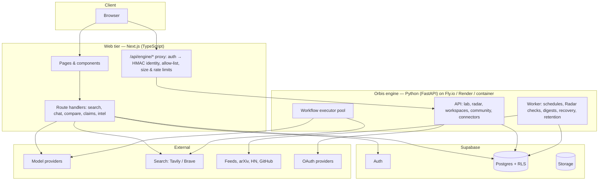
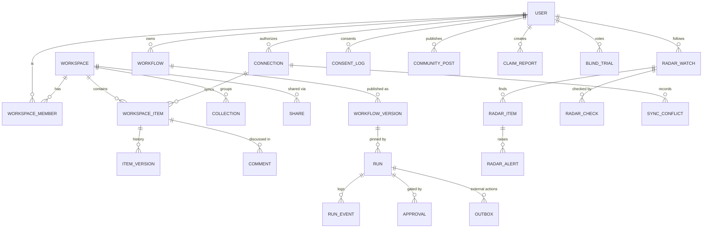

# Part 10 — Technical Architecture & Launch Roadmap

Principal-architect view of Orbis AI across Parts 1–9: what runs where, why,
how data is isolated and protected, and how to ship it in phases.

**Status legend used below:** ✅ implemented in this repository · 🟡 designed, partially implemented · 🔜 planned.

---

## 1. Assumptions

1. Users are individuals and small teams (≤ 50 members per workspace) at launch; tens of thousands of monthly active users within the first year.
2. Model providers are reached over HTTPS APIs (OpenAI-compatible, Hugging Face Inference Providers, and others later). No self-hosted GPUs at launch.
3. Supabase (managed Postgres + Auth + Storage) is acceptable for data residency in the launch regions. EU residency would use an EU Supabase project.
4. Background work (Radar checks, scheduled workflows, connector syncs, digests) must run outside request lifetimes. Vercel functions are not suitable for it.
5. The team is small (3–6 engineers) and fluent in TypeScript; data and agent work is easier in Python.
6. Correctness and safety beat feature breadth. Anything not implemented is labelled as such in the product.

## 2. Alternatives considered

| Decision | Options | Choice and rationale |
|---|---|---|
| Web tier | **Next.js + TypeScript** · Remix · SPA + separate API | **Next.js 16 (App Router)** ✅ — already built (Parts 1–5). Server components and route handlers act as a backend-for-frontend; Vercel deploys it well; React 19 ecosystem. |
| Long-running / agent / background work | Next.js route handlers only · **Python service** · Java/Kotlin (Spring) service · Go service · managed workflow engines (Temporal, Inngest) | **Python 3.12+ / FastAPI "Orbis engine"** ✅. Workflow execution, feeds, scheduling and connector syncs need long-lived processes and background workers, which serverless functions handle poorly. Python has the best ecosystem for retrieval, parsing, evaluation and future ML (pgvector clients, document parsing, scikit-learn). **Java was considered**: strong typing and the JVM are excellent for large teams, but a second statically typed stack adds operational weight (JVM tuning, build chain) without a capability Python lacks here. Revisit only if the engine needs very high-throughput concurrency. Temporal is the planned upgrade if workflow volume outgrows the built-in executor (§16). |
| Auth | **Supabase Auth** · Auth.js · Clerk | **Supabase Auth** ✅ — integrates with Postgres RLS via `auth.uid()`, email/password and OAuth providers, no extra vendor. |
| Database | **Postgres (Supabase)** · MySQL · document DB | **Postgres** ✅ — RLS, JSONB for flexible documents (reports, specs, items), strong consistency, pgvector for retrieval, point-in-time recovery. The engine uses SQLAlchemy Core so the same code runs on SQLite for local development and tests. |
| Engine ↔ web trust | Shared DB credentials only · Supabase JWT forwarding · **HMAC-signed identity** | **HMAC identity header** ✅ — the web tier authenticates the user and signs `{sub, email, name, exp}` with `ORBIS_ENGINE_SECRET` (TTL 2 min, max 5). The engine never handles passwords or sessions. Forwarding the Supabase JWT (verified with the JWKS) is the alternative once the engine also enforces RLS directly (🔜). |
| Semantic retrieval | **pgvector** · Pinecone · Weaviate | **pgvector** 🔜 — one database, RLS applies to embeddings too, no data copied to another vendor. Lexical search is used today. |
| Knowledge graph | **Postgres adjacency tables** · Neo4j · RDF store | **Postgres tables (`entities`, `relations`, both with provenance)** 🔜 — graphs are per workspace and small (< 1M edges), so recursive CTEs are enough; avoids a second datastore. Revisit Neo4j at > 10M edges or heavy path queries. |
| Background jobs | Vercel Cron only · Redis/BullMQ · **Postgres row leases + worker** · Celery | **Postgres leases + Python worker** ✅ — `UPDATE … WHERE lease_until < now()` claims rows atomically (Radar); runs have heartbeats. No extra infrastructure; migrate to Redis/Celery or Temporal when throughput requires it. |
| Rate limiting | In-memory · **Redis/Upstash** · Postgres | In-memory per instance ✅ today (web and engine) → **Upstash Redis** 🔜 before horizontal scaling. Daily quotas already use Postgres counts (`model_runs`). |
| Object storage | **Supabase Storage** · S3 | **Supabase Storage** 🔜 for uploads and exports, with RLS-protected buckets. |
| Observability | Vendor APM · **OpenTelemetry + Sentry** | **Structured logs with request ids** ✅ (engine logs method, path, status, latency, request id; web has the `reportError` seam) → **OpenTelemetry traces + Sentry** 🔜. |

## 3. System context and boundaries

**Boundary rules:**

1. The browser never calls the engine or a provider directly.
2. Provider keys live only in the web server and engine environments.
3. The engine trusts only signed identities, and scopes every query to them.
4. Retrieved and imported content is untrusted everywhere.

## 4. Application modules

| Module | Tier | Responsibilities | Parts |
|---|---|---|---|
| `lib/ai` | web | Provider interface, registry, router, cost | 1, 5 |
| `lib/search` | web | Web search, grounding, citations | 2 |
| `lib/claims` | web (shared, pure) | Claim DNA pipeline, Hypothesis Arena, Research Replay | 4 |
| `lib/intel` | web (shared, pure) | Blind trials, benchmarks, fingerprint, routing, pricing | 5 |
| `lib/db`, `lib/auth`, `lib/usage`, `lib/http` | web | Supabase data access (RLS), auth, quotas, errors | 1–5 |
| `lib/engine` + `api/engine/[...path]` | web | Identity signing and the engine proxy | 7–9 |
| `orbis_engine.lab` | engine | Planner, validator, executor, templates, tests, versions | 7 |
| `orbis_engine.radar` | engine | Sources, analysis, alerts, digests, freshness | 8 |
| `orbis_engine.workspace` | engine | Workspaces, permissions, items, versions, comments, collections, shares, community, portability | 9 |
| `orbis_engine.connectors` | engine | Catalog, OAuth, token vault, sync, conflicts, consent | 9 |
| `orbis_engine.security` | engine | Untrusted-content handling, sensitive-data detection, tool policy, SSRF guard, crypto | 7–9 |
| `orbis_engine.worker` | engine | Background passes | 7–9 |

## 5. Data model

Web tier (Supabase migrations, RLS on every table) ✅: `profiles`, `projects`, `conversations`, `messages`, `search_sessions`, `sources`, `model_registry`, `model_price_history`, `model_runs`, `model_comparisons`, `favorite_models`, `project_notes`, `radar_tasks` (legacy placeholder), `claim_reports`, `hypothesis_arenas`, `blind_trials`, `benchmark_runs`.

Engine (`engine/orbis_engine/db.py`) ✅: `workflows`, `workflow_versions`, `runs`, `run_events`, `approvals`, `outbox`, `tool_grants`, `radar_watches`, `radar_items`, `radar_checks`, `radar_alerts`, `radar_digests`, `radar_profiles`, `http_cache`, `workspaces`, `workspace_members`, `workspace_items`, `item_versions`, `comments`, `collections`, `shares`, `community_posts`, `community_reports`, `connections`, `oauth_states`, `consent_log`, `sync_conflicts`, `audit_log`, `worker_heartbeats`.

**Planned consolidation** 🔜: personal `projects` become single-member workspaces (a migration copies `project_notes` → `workspace_items`), so there is one project concept. Knowledge-graph tables (`entities`, `relations` with `workspace_id`, `source_item_id`, `confidence_label`) and `embeddings` (pgvector, `workspace_id`, `item_id`, `model`, `dim`) join the engine schema.

## 6. API contracts

- **Web API** (`src/app/api/*`): JSON or NDJSON streaming. Zod-validated bodies with size limits. Error envelope `{error: {code, message, details}}`.
- **Engine API**: OpenAPI generated by FastAPI at `/docs` (development). Same error envelope and codes. All endpoints require `X-Orbis-Identity`. Each request gets an `x-request-id` (propagated from the web tier).
- **Versioning:** additive changes only within v1. Breaking changes go to a `/v2` prefix on the engine, and the web proxy pins the version it understands.
- **Idempotency:** external actions use outbox keys. Client retries of `POST` create endpoints can be made safe with an `Idempotency-Key` header (🔜).
- Endpoint catalogs: `docs/AI_LAB.md` §9, `docs/SIGNAL_RADAR.md` §14, `docs/WORKSPACES_INTEGRATIONS.md` §10, `docs/CLAIM_DNA.md`, `docs/MODEL_INTELLIGENCE.md`.

## 7. Authorization and data isolation

| Layer | Mechanism |
|---|---|
| Identity | Supabase Auth (`getUser()` validated server-side) → HMAC identity to the engine. Guests get a random `orbis_guest` httpOnly cookie, so their demo data is separate per browser. |
| Web data | Postgres **RLS** on every table (`user_id = auth.uid()`). `owns_project()` stops cross-tenant references. Tested with PGlite in `tests/rls.test.ts`. |
| Engine data | Every service function scopes by owner or verified workspace membership. Non-members get 404. The role matrix is in `workspace/permissions.py`. Tests cover cross-user access. |
| Engine data, defence in depth 🔜 | Connect as a dedicated `orbis_engine` Postgres role **without** `BYPASSRLS`, and set `app.user_id` per transaction (`SET LOCAL`). RLS policies: `owner_id = current_setting('app.user_id')`, plus membership checks via `workspace_members` for workspace tables. |
| Tools and connectors | Per-user tool grants plus per-workflow permissions plus run-time approval policy. OAuth scopes are checked before writes. |
| Admin | No service-role key in the web tier. Registry and price writes go through SQL or an admin console (🔜) with an audit log. |

## 8. Secrets and sensitive data

- **Server-only secrets:** `OPENAI_API_KEY`, `HUGGINGFACE_API_KEY`, `SEARCH_API_KEY`, `ORBIS_ENGINE_SECRET`, `ORBIS_TOKEN_KEYS`, `ORBIS_TRIAL_SECRET`, `GITHUB_CLIENT_SECRET`. They live in Vercel and engine environment stores, and are never prefixed `NEXT_PUBLIC_`. The Settings page shows booleans only.
- **OAuth tokens:** AES-256-GCM with key ids and AAD binding; rotation by prepending a key and re-encrypting in the background.
- **Sensitive inputs:** marked per workflow input, masked in logs, and gated before leaving Orbis (model providers or egress tools). The detector catches emails, phones, Luhn-valid cards, SSNs, IBANs and common API key formats.
- **Retention:**
  - Radar items: 90 days by default (user-configurable 7–365), purged by the worker.
  - Run events: retained with the run; deleting a workflow archives it.
  - A per-user "delete all my data" job is planned 🔜 (cascades through engine tables; Supabase `auth.users` deletion cascades web tables already).
- **Deletion:**
  - Workspaces are soft-deleted (revoking all shares), then hard-deleted after 30 days 🔜.
  - Connections can hard-delete synced data immediately.
  - Exports never include secrets.

## 9. Prompt injection and untrusted content

Applies to search answers (Part 2), Claim DNA (Part 4), AI Lab (Part 7), Radar (Part 8) and imports/community/connectors (Part 9):

1. **Separate instructions from data.** Retrieved text is wrapped in delimiters after neutralising look-alike tags and invisible characters. System prompts say delimited content is data.
2. **No model-initiated actions.** Models never call tools. The workflow graph and approvals are fixed before execution.
3. **Taint tracking.** Untrusted-derived parameters force approval. Injection patterns are flagged in the UI and logs.
4. **Verification over trust.** Claim DNA counts a model judgement only if its quote is found verbatim in the source.
5. **Network egress.** Domain allow-lists, plus an SSRF guard that resolves hosts and blocks private, loopback, link-local and metadata addresses on every redirect hop.
6. **Rendering.** Markdown is rendered to React elements (no raw HTML). Only http(s) links are clickable, with `rel="noopener noreferrer nofollow"`.

## 10. Abuse prevention, rate limits and quotas

| Control | Where |
|---|---|
| Per-minute rate limits | Web: `ORBIS_RATE_LIMIT_PER_MINUTE` per user or IP (default 20 AI requests per minute; engine proxy 240 per minute per IP). Engine: token bucket of 120 per minute per identity, with writes costing 5. |
| Usage limits | Signed-in users: Claude-style 5-hour window plus a weekly cap per plan (`src/lib/plans.ts`, counted from `model_runs`, plan from `subscriptions`). Guests: `ORBIS_DAILY_REQUEST_LIMIT`. |
| Workflow limits | Per-run budgets (cost, calls, tokens, steps, duration), ≤ 5 active runs per user, ≤ 200 workflows. |
| Radar limits | ≤ 50 watches per user, 3 manual checks per watch per 10 minutes, daily paid-search cap. |
| Workspace limits | ≤ 100 workspaces per user, 50 members, 5000 items, 500 KB per item. Body limits: 2 MB (10 MB for import). |
| Community | Signed-in publishing, sensitive-data scan, report-to-hide at 3 reports, audit trail. |
| Bots | Supabase Auth email confirmation; CAPTCHA on sign-up 🔜; IP reputation at the edge (Vercel Firewall) 🔜. |

## 11. Cost controls

- **Prices:** verified, source-linked prices with staleness checks (Part 5). Costs show "n/a" instead of invented numbers.
- **Per-run budgets** are enforced before each model call; deterministic pipelines are the default (Claim DNA rules, Radar scoring, benchmark checkers).
- **Caching and timeouts:** conditional GETs for feeds; search and HF Hub caching; timeouts everywhere (web model calls 45–50 s, engine model calls 60 s by default, fetches 20–30 s).
- **Cheaper defaults:** route to cheaper models when evidence supports it (Part 5); daily web-search caps (Radar).
- **Monitoring** 🔜: daily spend per user from `model_runs.estimated_cost` with alerts at 80% of budget; reconciliation against provider billing exports (Part 5 `reconcile`).

## 12. Observability and error handling

- **Errors:** stable error codes and envelopes on both tiers. NDJSON streams emit `error` events instead of breaking the stream. Unexpected engine errors are logged with a stack trace and returned as `internal` without details.
- **Request ids:** the engine logs method, path, status, latency and request id; the proxy generates a request id per call.
- **Run and job logs:** run event logs are user-visible; radar checks and connector syncs record stats and errors per execution; the worker heartbeat is exposed in the UI.
- 🔜 OpenTelemetry tracing across web → engine → providers (trace context in the proxy headers).
- 🔜 Sentry on both tiers (the web seam already exists).
- 🔜 Dashboards: p50/p95 latency per endpoint, provider error rates, queue lag (due watches not yet checked), approval wait time, spend.

## 13. Caching

- **Web:** model list cache (client), HF discovery cache (in-memory → Redis 🔜), `Cache-Control: no-store` on user data.
- **Engine:** HTTP cache table (ETag / Last-Modified bodies) for feeds; no caching of user data.
- **Not cached:** model outputs are deliberately not cached across users (privacy). Per-user prompt caching at the provider is a future cost lever.

## 14. Migrations

- **Web:** SQL files in `supabase/migrations/` (timestamped, applied with `supabase db push`). CI applies all of them to PGlite and runs the RLS tests.
- **Engine:** `metadata.create_all` today (additive only). Before production 🔜, adopt **Alembic** with autogenerate plus review. Use the expand → migrate → contract pattern for breaking changes. Run migrations from a release job before rolling the engine.
- **Data migrations** (e.g. projects → workspaces) run as idempotent, resumable scripts with dry-run reports.

## 15. Testing strategy

| Level | What | Now |
|---|---|---|
| Unit (TS) | Claim DNA, intel statistics, routing, pricing, search grounding, cost | ✅ Vitest, 103 tests |
| Route handlers (TS) | Guest/demo flows, validation, blinding | ✅ |
| Database security | RLS for every web table, as two users | ✅ PGlite |
| Unit / integration (Python) | Security (identity, injection, sensitive data, crypto, SSRF), Lab (validation, expressions, approvals, budgets, retries, resume, idempotency, taint, tests, versions, planner), Radar (dedupe, labels, scoring, baseline, alerts, digests, freshness), Workspaces / community / connectors, API | ✅ pytest, 54 tests |
| End-to-end | Browser flows across Parts 4–9 (plan → build → dry run; approval; workspaces; radar; share link; mobile overflow) | ✅ Playwright script used during development; 🔜 checked into CI against an ephemeral Supabase project |
| Red-team | Prompt-injection corpus against Lab/Claim DNA; SSRF payload list; authorization fuzzing | 🔜 |
| Load | k6: 200 concurrent users on chat/search; 1,000 due watches per worker pass | 🔜 |

## 16. Deployment

| Component | Platform | Notes |
|---|---|---|
| Web | Vercel | Env vars per environment; streaming routes `maxDuration` 60–120 s. |
| Engine API | Fly.io / Render / any container host (2+ instances behind TLS, private networking to the web tier preferred) | `uvicorn orbis_engine.api.app:app --workers N`; health check `/health`. |
| Worker | Same image, separate process (`python -m orbis_engine.worker`) | ≥ 1 instance. Leases make several safe. Alternatively `--once` from a scheduler every minute. |
| Database | Supabase Postgres | Engine uses `ORBIS_ENGINE_DATABASE_URL` (pooler, transaction mode), with a dedicated role. |
| Secrets | Vercel env + host secret store | `ORBIS_ENGINE_SECRET` must match on both tiers. |

**Environments:** preview (per PR, demo mode), staging (real Supabase project, test OAuth apps), production.

**Releases:** migrations first, then engine (rolling), then web (atomic deploy). Feature flags gate new connectors.

**Scale path:** executor threads → a queue (Redis/Celery) → **Temporal** for durable workflows if runs > ~10k/day or need multi-day waits. Radar worker sharding by `hash(watch_id)`.

## 17. Backup and recovery

| Asset | Backup | RPO / RTO target |
|---|---|---|
| Postgres (web and engine) | Supabase daily backups + **PITR** (Pro plan) | RPO ≤ 5 min, RTO ≤ 1 h |
| Storage | Supabase Storage replication; export bundles are user-held copies | RPO ≤ 24 h |
| Secrets | Host secret stores; encryption keys escrowed offline (two-person access) | — |
| Workflow runs | Checkpoints per step; worker marks stale runs `interrupted`; users resume | No step repeated (idempotency keys) |

Quarterly restore drills to a scratch project (with checksum comparison of row counts and sample documents). A runbook covers key compromise: rotate `ORBIS_ENGINE_SECRET` (2-minute token TTL limits exposure) and `ORBIS_TOKEN_KEYS` (re-encrypt, then drop the old key), and force-reconnect integrations if needed.

## 18. Phased implementation plan

| Phase | Scope | Depends on | Acceptance criteria | Status |
|---|---|---|---|---|
| **0 Foundation** | Next.js shell, Supabase auth, RLS schema, search, chat, model registry, battle | — | RLS tests pass; demo mode works without keys | ✅ |
| **1 Trust & Intelligence** (Parts 4–5) | Claim DNA, Arena, Replay, blind trials, benchmarks, fingerprint, routing, directory | 0 | No confidence shown as truth; sample-size gating; 103 TS tests | ✅ |
| **2 Engine MVP** (Parts 7–9 core) | Python engine, signed identity, Lab (plan → build → run, approvals, budgets, versions, tests, templates), Radar (baseline, labels, ranking, alerts, digests, honest status), Workspaces (roles, versions, comments, sharing, export/import), Community, RSS + GitHub public connectors | 0 | 54 engine tests; e2e flow; no consequential action without an approval bound to its payload; SSRF guard; no secrets in the browser | ✅ (this release) |
| **3 Production hardening** | Alembic; engine on Postgres with a dedicated role + RLS (`app.user_id`); Upstash rate limits; OpenTelemetry + Sentry; `ORBIS_TOKEN_KEYS` rotation runbook; delete-my-data job; CAPTCHA | 2 | Pen-test with no high findings; restore drill passes; p95 API < 500 ms (non-model); error budget 99.5% | 🔜 |
| **4 Accounts & documents** | GitHub OAuth app, Google Drive (`drive.file`), Notion; Storage uploads with PDF/DOCX parsing; email provider (invitations, digests, `email.send`) | 3 | OAuth verified; revocation tested; email deliverability > 98% | 🔜 |
| **5 Knowledge layer** | pgvector embeddings for items, claims and radar; semantic search; knowledge graph (entities/relations with provenance) and graph view; merge projects into workspaces | 3 | nDCG@10 ≥ 0.7 on a labelled set; migration dry-run with zero loss | 🔜 |
| **6 Scale & collaboration** | Parallel workflow branches; Temporal (if needed); real-time co-editing; moderation console; public workspace pages; What-If Simulator | 4, 5 | 10k runs/day sustained; moderation SLA < 24 h | 🔜 |

**MVP for public launch** = Phases 0–3: everything in this repository plus production hardening. Phase 4 connectors are not required for launch; the product states which integrations are available.

## 19. Risks and mitigations

| Risk | Likelihood / impact | Mitigation |
|---|---|---|
| Prompt injection causes an unwanted action | Medium / High | No model-initiated tools; payload-bound approvals; taint tracking; red-team corpus in CI (🔜). |
| Cost overrun from model or search use | Medium / Medium | Budgets, quotas, daily caps, verified prices, spend alerts. |
| Cross-tenant data leak in the engine | Low / Critical | Service-level scoping (tested), Postgres RLS with a dedicated role (Phase 3), authorization fuzzing. |
| Provider API or pricing changes | High / Medium | Provider abstraction, model-list sync, price staleness warnings, fallbacks. |
| Feed / source availability or blocking | Medium / Low | Per-source errors surfaced as watch freshness; conditional GET; polite rates. |
| OAuth verification delays (Google) | High / Medium | `drive.file` minimal scope; ship GitHub and RSS first. |
| Single-process executor limits | Medium / Medium | Leases and heartbeats now; queue/Temporal path defined. |
| Over-trust in AI outputs | Medium / High | Labels, limitations, citations, "not truth" copy, evaluation gates (Parts 4–5). |
| Team context switching between TS and Python | Medium / Low | A clear module boundary (engine API), shared conventions (error envelope, ids), contract tests. |

## 20. Future enhancements

Parallel and long-wait workflows; signed inbound webhook triggers; per-user model-written digests with citation validation; semantic Radar ranking; knowledge graph extraction from Claim DNA; collaborative editing; organisation accounts with SSO/SCIM; data residency selection; mobile app with push notifications for approvals and alerts; marketplace for verified connectors.
