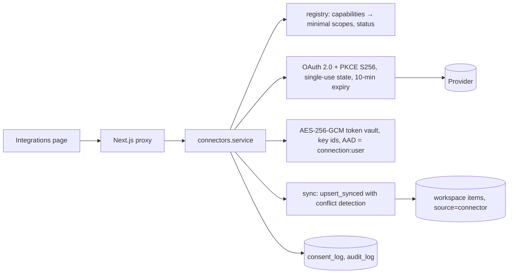

# Part 9 — Projects, Community & Integrations

Workspaces give a project one shared context — chats, documents, research,
knowledge graphs, tasks, workflows and decisions — with roles, comments,
version history, collections, sharing and data portability. Community lets
people publish reusable templates and collections. Integrations connect
outside apps with explicit consent, minimal access and a clean way out.

Code: `engine/orbis_engine/workspace/*`, `engine/orbis_engine/connectors/*`, `src/components/workspaces/*`, `src/components/community/*`, `src/components/integrations/*`.

---

## 1. Project journeys

| Persona | Journey |
|---|---|
| **Analyst (solo)** | Create a workspace → AI Lab "Research brief" saves a cited brief into it → Claim DNA checks it → log a **decision** with rationale and evidence → export the workspace as a bundle for the client. |
| **Team lead** | Create a workspace → invite teammates (editor) and stakeholders (commenter) → tasks with status → stakeholders comment on documents → resolve threads → restore an earlier version of a document after a bad edit. |
| **Engineer** | Connect GitHub (public mirror or OAuth) → issues sync into the workspace as tasks → a workflow drafts a new issue from notes, which needs approval before it is created. |
| **Researcher** | Follow arXiv topics in Radar → save signals into a **knowledge collection** → publish the collection to Community (after the sensitive-data scan) → others fork it into their own workspaces. |
| **Leaving or switching tools** | Export JSON (optionally with full history) → import elsewhere or into another Orbis instance with a dry-run preview → disconnect integrations with "delete synced data". |

## 2. Workspace model

- **Item types:** note, document, research, chat, graph, task (todo/doing/done/blocked), workflow, decision (proposed/accepted/rejected/superseded, with rationale and evidence), link (http(s) only), dataset. Each item is limited to 500 KB of JSON.
- **Versions:** every save writes an immutable `item_versions` row (author, time, change note). Saves are **optimistic-concurrency** protected (`expected_version` → `409 conflict`, "reload and re-apply"). **Restore** creates a new version; history is never rewritten.
- **Comments:** threaded (`parent_id`), optional anchor, resolve/unresolve (by the author or editors+), soft delete (by the author or admins).
- **Collections:** named, ordered sets of item ids (for example "Key evidence"). They can be published to Community.
- **Provenance:** items carry `source` (connector, import, community, workflow run) and an `untrusted` flag. AI Lab treats all workspace content retrieved by workflows as untrusted data.

## 3. Roles and permissions

| Action | owner | admin | editor | commenter | viewer |
|---|---|---|---|---|---|
| read | ✓ | ✓ | ✓ | ✓ | ✓ |
| comment | ✓ | ✓ | ✓ | ✓ | — |
| edit / delete items, manage collections, run workflows, export | ✓ | ✓ | ✓ | — | — |
| manage members, create share links, manage connectors, publish to community | ✓ | ✓ | — | — | — |
| change visibility, delete workspace, transfer ownership | ✓ | — | — | — | — |

- **Role assignment:** admins can assign up to editor. Only owners make admins. "Owner" moves only by **transfer**, and the old owner becomes an admin. Anyone can leave, except the owner before transferring.
- **Invitations:** invitations are by email and are accepted automatically when that verified email signs in. No email is sent by this deployment.
- **Non-members:** non-members get `404 not found` (existence isn't revealed).
- **Single source of truth:** `workspace/permissions.py`, also shown in the UI.

## 4. Sharing

| Mode | Behaviour |
|---|---|
| Private (default) | Members only. |
| **Link** | Admins create viewer/commenter links scoped to the workspace or one item, with expiry (1/7/30 days or never). The token is shown **once**; only its SHA-256 is stored. Revocable. The `/share/[token]` page is read-only and not indexed. |
| **Public / Community** | Explicit publishing of a **snapshot** (later edits don't leak). |

## 5. Community contributions

- **What can be published:** workflow templates, Radar watch templates and knowledge collections, under a license (CC-BY-4.0, CC0-1.0, MIT or All rights reserved). Publishing requires a signed-in account.
- **Safety on publish:**
  - Sensitive inputs and defaults that look personal are stripped from workflows.
  - Content is scanned for emails, phones, cards, IBANs and API keys. Publishing is **blocked** until the user removes them or explicitly confirms.
- **Discovery:** filter by kind, keyword search, and built-in examples (the Lab templates, labelled).
- **Forking:** workflows become **drafts** (review, then publish), watches become new watches, and collections become items marked `untrusted` in a chosen workspace. Instruction-like text in a post is flagged before forking.
- **Moderation:**
  - One report per user per post.
  - **3 reports hide a post** pending review.
  - Authors can unpublish.
  - Publish, fork and report actions are audit-logged.

## 6. Safe import / export

- **Export:** the `orbis-workspace` v1 JSON contains items (with optional full history), comments, collections, and a manifest with item count, SHA-256 of items, and excludes. It **never** contains OAuth tokens, share tokens or connector credentials. Member emails are included only when an admin asks.
- **Import:**
  - Always previewed first (dry run): counts, skipped items, warnings.
  - Checks: 10 MB limit, ≤ 5000 items, format/version check, checksum verification (warning on mismatch), unknown fields dropped, item types whitelisted, size limits, and an injection-pattern scan (flagged items are imported as untrusted).
  - Members are never imported automatically.
  - Items get new ids and `source.imported = true`.

## 7. Connector architecture

| Concern | Design |
|---|---|
| **Supported apps** | The catalog lists each provider's honest status: *available*, *available (limited)*, *planned*, *not planned* (see §8). |
| **OAuth** | Authorization Code with **PKCE S256**. `state` is random, stored hashed, single-use, bound to the user, and expires in 10 minutes. The redirect URI is fixed to `/api/engine/connectors/oauth/callback`, which returns to `/integrations`. |
| **Minimal permissions** | Users pick a **capability**, and the engine requests only that capability's scopes (e.g. GitHub "create issues in public repos" → `public_repo`; Google Drive → `drive.file`, never `drive.readonly`). Granted scopes are stored and shown. Write tools check the scope before acting. |
| **Token security** | AES-256-GCM with key ids (`ORBIS_TOKEN_KEYS`, rotation by prepending a key). AAD binds a ciphertext to its connection and user. Tokens never leave the engine or reach the browser, and are never logged. Without configured keys a per-process dev key is used. |
| **Revocation** | Disconnect calls the provider's revocation endpoint when one exists (GitHub grant deletion, Google revoke), deletes the ciphertext, and records the result. If revocation can't be confirmed, the UI says so and links to the provider's settings. |
| **Sync status** | Per connection: `never / running / ok / partial / error`, last attempt, last success, counts (created/updated/unchanged/conflicts), error text, and remaining API rate limit. |
| **Conflict handling** | Each synced item stores `remote_version` and `synced_version`. Remote changed and local unchanged → update (remote wins for mirrored fields). Both changed → **conflict record**, no overwrite; the user picks *keep mine* or *use source*. Local-only edits are never pushed back by read-only mirrors. |
| **Data deletion** | Disconnect can also hard-delete every item that connection synced, including version history and conflicts. A `data_deleted` consent record is written. |
| **Consent** | `consent_log` records grants (scopes, purpose), revocations and deletions. Users can see this history on the Integrations page. |

## 8. Integration priorities

Scored by user value (V) and implementation feasibility (F), each 1–5.

| Priority | Connector | V | F | Status in this release | Notes |
|---|---|---|---|---|---|
| P0 | RSS / Atom | 4 | 5 | **available** | No auth; also a Radar source. |
| P0 | GitHub | 5 | 5 | **available**: public mirror without sign-in; OAuth once the operator registers an app | GitHub App recommended for per-repo permissions. |
| P0 | arXiv | 4 | 5 | **available** (Radar source) | Public API; polite rate. |
| P1 | Hacker News | 3 | 5 | **available** (Radar source) | Discussion = speculative. |
| P1 | Slack incoming webhook | 4 | 5 | **available** via AI Lab `http.post` | The webhook URL is the secret; domain allow-list. |
| P1 | Google Drive | 5 | 3 | planned | `drive.file` + Picker; verification needed for broader scopes. |
| P1 | Notion | 4 | 3 | planned | Page-level grants chosen by the user. |
| P2 | Zotero | 3 | 4 | planned | Read-only API key. |
| P3 | Google Calendar | 2 | 3 | planned | Sensitive-scope verification. |
| P3 | Gmail | 3 | 1 | planned | Restricted scopes require a paid security assessment. |
| — | X / Twitter | 2 | 1 | not planned | Paid API, restrictive terms. |
| — | LinkedIn | 2 | 1 | not planned | No suitable general API. |

Nothing assumes an account is already connected. Every write path checks for an active connection with the right scope, and fails with a clear message when there isn't one.

## 9. Rollout phases

| Phase | Scope | Exit criteria |
|---|---|---|
| **1 — Foundations** (done here) | Workspaces, roles, items, versions, comments, collections, link sharing, export/import, community publish/fork/report, RSS + GitHub public mirror, consent log | All `test_workspace.py` cases pass. A security review signs off on authorization and the share-token design. |
| **2 — Accounts** | GitHub OAuth app/GitHub App in production; `ORBIS_TOKEN_KEYS` with rotation runbook; invitations by email (provider); Postgres RLS on engine tables (ARCHITECTURE §7) | OAuth end-to-end on staging; revocation confirmed against GitHub; RLS tests. |
| **3 — Documents** | Google Drive (`drive.file` + Picker), Notion; document text extraction feeding Claim DNA | Google OAuth verification passed; conflict UX validated with 5 users. |
| **4 — Collaboration depth** | Real-time presence and co-editing (CRDT), @mentions and notifications, community moderation console, public workspace pages | Abuse-handling SLA defined; moderation queue staffed. |

## 10. Interfaces

Workspaces:

- `GET/POST workspaces`; `GET/PATCH/DELETE workspaces/{id}`.
- Members: `POST/PATCH/DELETE workspaces/{id}/members[/{mid}]`, including `{transfer_ownership: true}`.
- Items: `POST workspaces/{id}/items`; `GET/PUT/DELETE …/items/{iid}`; `GET …/items/{iid}/versions/{v}`; `POST …/restore`.
- Comments: `POST …/items/{iid}/comments`; `PATCH/DELETE workspaces/{id}/comments/{cid}`.
- Other: `GET …/search?q=`; `POST/DELETE …/collections[/{cid}]`; `POST/DELETE …/shares[/{sid}]`; `GET share/{token}`; `GET …/export?history&members`; `POST workspaces/import?dry_run&workspace_id`.

Community: `GET/POST community`; `GET/DELETE community/{id}`; `POST community/{id}/fork`; `POST community/{id}/report`.

Integrations:

- `GET connectors` (catalog, connections, consents).
- `POST connectors/{id}/connect` (`config`, or `oauth + capability`); `GET connectors/oauth/callback`.
- `PATCH/DELETE connections/{id}?delete_data`; `POST connections/{id}/sync`; `GET connections/{id}/conflicts`; `POST conflicts/{id}`.

## 11. Evaluation

| Criterion | Test |
|---|---|
| Isolation: non-members can't read, and existence is hidden | `test_invites_roles_and_isolation`, `test_workspace_and_radar_endpoints` |
| Role enforcement (commenter can't edit; editor can't invite; admin can't make admins) | `test_invites_roles_and_isolation`, `test_permission_matrix` |
| No silent overwrites | `test_versions_restore_and_optimistic_concurrency` |
| Share links: hashed, read-only, revocable, viewer/commenter only | `test_share_links_are_read_only_hashed_and_revocable` |
| Portability round-trip with checksum and injection warnings | `test_export_import_roundtrip` |
| Community privacy and moderation | `test_community_publish_scan_fork_report`, `test_community_blocks_sensitive_collections` |
| Sync conflicts, consent trail, data deletion | `test_connector_sync_conflicts_and_deletion` |
| OAuth refuses without configuration or for guests | `test_oauth_requires_configuration_and_sign_in` |
| Product | Weekly active workspaces with ≥ 2 members; share-link revocation rate; % of exports re-imported successfully (target 100%) |
